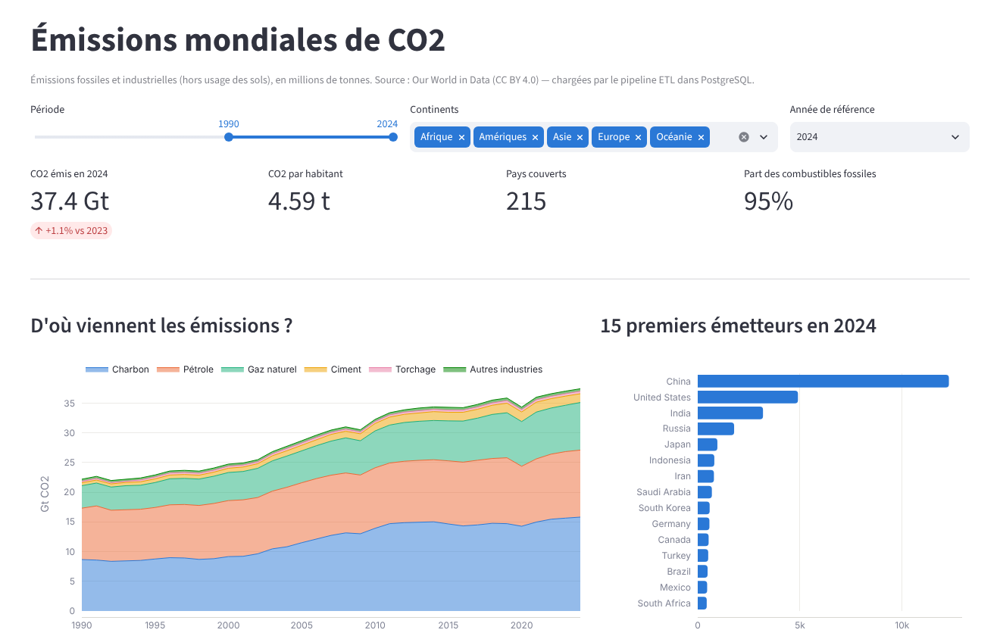
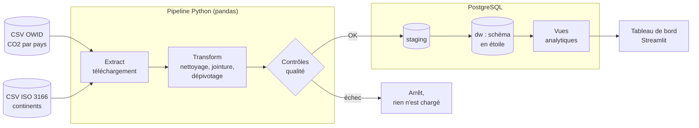
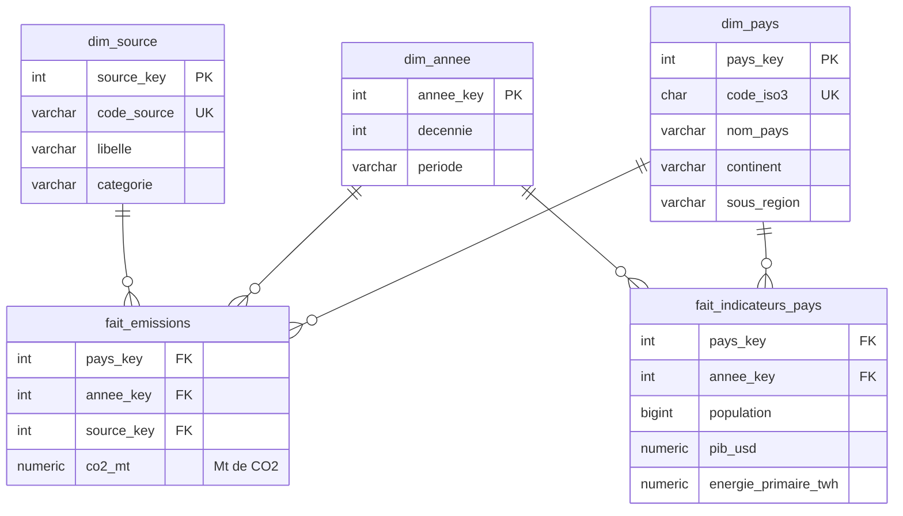

# Pipeline de données et tableau de bord — Émissions mondiales de CO2

Pipeline **ETL en Python (pandas)** qui extrait des **données ouvertes**, les nettoie et les charge dans un **entrepôt PostgreSQL en schéma en étoile**, puis un **tableau de bord Streamlit** d'indicateurs construit sur cet entrepôt.



> 📘 Vous découvrez ces notions ? Lisez d'abord le **[guide d'explication](docs/GUIDE.md)** : ETL, entrepôt, schéma en étoile, clés de substitution, idempotence… tout y est expliqué pas à pas, avec le code correspondant.

## En bref

| | |
|---|---|
| **Sources** | [Our World in Data — CO2](https://github.com/owid/co2-data) (CC BY 4.0) + [codes ISO 3166 et régions](https://github.com/lukes/ISO-3166-Countries-with-Regional-Codes) (CC BY-SA 4.0) |
| **Volume** | 219 pays × 75 ans (1950 → 2024) → ~60 000 faits d'émission, ~16 000 faits d'indicateurs |
| **Stack** | Python 3.12, pandas, SQLAlchemy, PostgreSQL 16, Streamlit, Plotly, pytest, Docker, GitHub Actions |
| **Durée d'exécution** | ~5 s |

## Architecture



## Modèle de données (schéma en étoile)



- **Grain de `fait_emissions`** : un pays × une année × une source (charbon, pétrole, gaz, torchage, ciment, autres industries).
- **Grain de `fait_indicateurs_pays`** : un pays × une année. Les deux tables de faits partagent les mêmes dimensions (*dimensions conformes*).

## Lancer le projet

**Prérequis** : Python 3.10+ et PostgreSQL (ou Docker).

```bash
# 1. Récupérer le projet
git clone https://github.com/<votre-compte>/pipeline-co2-dashboard.git
cd pipeline-co2-dashboard

# 2. Environnement Python
python -m venv .venv
source .venv/bin/activate          # Windows : .venv\Scripts\activate
pip install -r requirements.txt

# 3. Configuration
cp .env.example .env               # Windows : copy .env.example .env

# 4. Base de données (au choix)
docker compose up -d               # avec Docker
# ou créer la base à la main dans un PostgreSQL existant :
#   CREATE USER etl_user WITH PASSWORD 'etl_password';
#   CREATE DATABASE entrepot_co2 OWNER etl_user;

# 5. Pipeline puis tableau de bord
python -m etl.pipeline
streamlit run dashboard/app.py     # -> http://localhost:8501
```

Options du pipeline : `--forcer` (re-télécharger les sources), `--sans-load` (tout exécuter sauf l'écriture en base).

## Structure du dépôt

```
pipeline-co2-dashboard/
├── etl/
│   ├── config.py        # paramètres (lus depuis .env)
│   ├── extract.py       # E : téléchargement des CSV
│   ├── transform.py     # T : nettoyage, dimensions, faits
│   ├── quality.py       # contrôles qualité bloquants / avertissements
│   ├── load.py          # L : staging -> dw dans une transaction
│   └── pipeline.py      # orchestration + logs
├── sql/
│   ├── 01_schema.sql            # schémas, dimensions, faits, journal
│   ├── 02_staging_vers_dw.sql   # upsert des dimensions, recharge des faits
│   └── 03_vues.sql              # vues pour le tableau de bord
├── dashboard/app.py     # tableau de bord Streamlit + Plotly
├── tests/               # tests unitaires pytest
├── docs/GUIDE.md        # explication détaillée du projet
├── docker-compose.yml   # PostgreSQL en un clic
└── .github/workflows/ci.yml  # tests + pipeline à chaque push
```

## Indicateurs du tableau de bord

- CO2 total de l'année et variation sur un an, CO2 par habitant, part des combustibles fossiles
- Évolution des émissions par source (aire empilée)
- 15 premiers pays émetteurs
- Carte du CO2 par habitant
- Évolution par continent
- Richesse (PIB/hab) et émissions par habitant
- Table des données filtrées, téléchargeable en CSV

Filtres : période, continents, année de référence.

## Choix techniques notables

- **Staging puis dw** : pandas dépose les données dans une zone de transit, le SQL les recopie dans l'entrepôt ; les clés de substitution sont générées par PostgreSQL et retrouvées par jointure sur la clé naturelle.
- **Idempotence** : relancer le pipeline donne toujours le même résultat (upsert des dimensions, rechargement complet des faits).
- **Transaction unique** : en cas d'erreur, rien n'est écrit — l'entrepôt n'est jamais à moitié chargé.
- **Contrôles qualité** avant chargement : unicité du grain, intégrité référentielle, valeurs négatives, cohérence somme des sources = total publié.
- **COPY** PostgreSQL au lieu de milliers d'`INSERT` pour le chargement en masse.
- **Journal des exécutions** dans `meta.journal_chargement`.
- **Tests unitaires** sur des mini-jeux de données construits à la main + **CI GitHub Actions** qui exécute le pipeline sur une vraie base.

## Pistes d'amélioration

- Traduire les noms de pays en français (table de correspondance supplémentaire)
- Planifier le pipeline (cron, Airflow ou GitHub Actions planifié)
- Ajouter d'autres sources ouvertes (méthane, énergies renouvelables…)
- Déployer le tableau de bord (Streamlit Community Cloud + base hébergée)

## Auteur

**Ayoub Boussoukaya** — étudiant en Licence Développement des Systèmes d'Information (ISET Djerba)

Données : Our World in Data, *CO2 and Greenhouse Gas Emissions* (CC BY 4.0).
